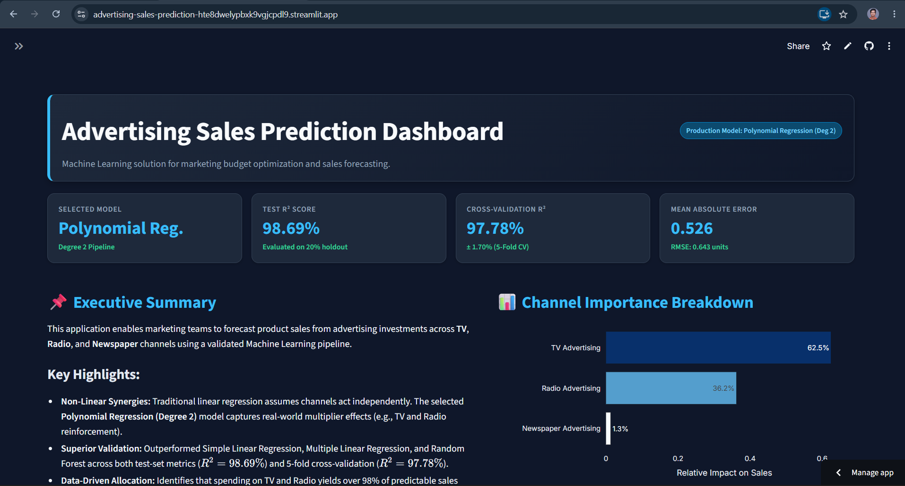
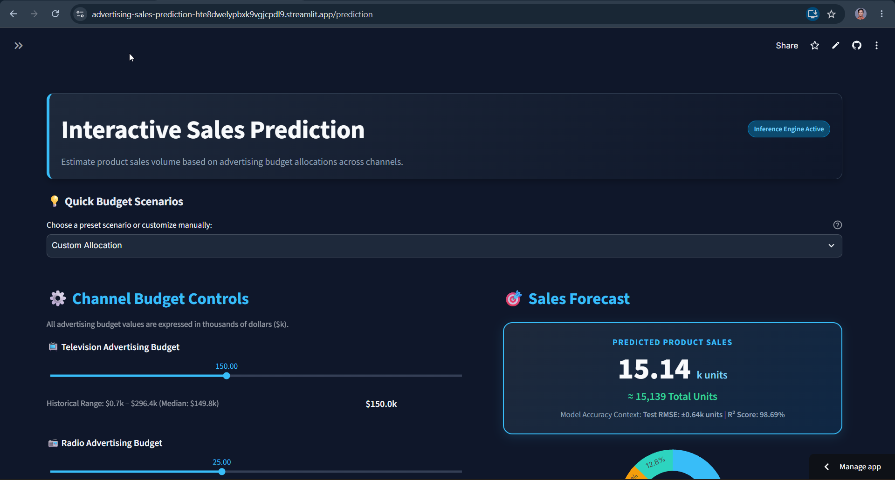
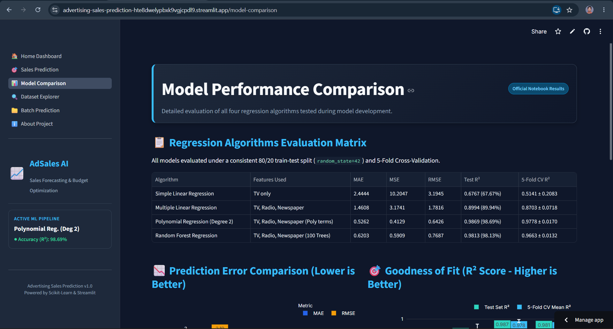
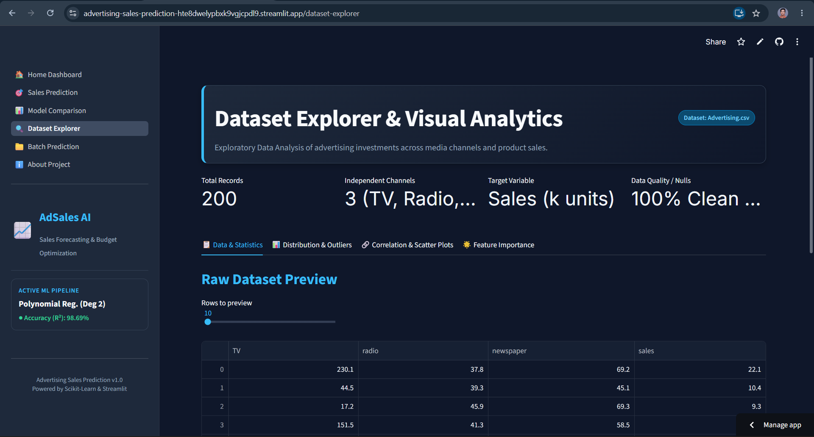

# 📊 Advertising Sales Prediction Using Machine Learning

An end-to-end Machine Learning project that analyzes advertising expenditure across TV, Radio, and Newspaper channels to predict product sales. The project compares four regression algorithms and provides an interactive web application built using Streamlit.

🌐 **Live Application:** [AdSales AI – Advertising Sales Prediction](https://advertising-sales-prediction-hte8dwelypbxk9vgjcpdl9.streamlit.app/)

💻 **GitHub Repository:** [Advertising Sales Prediction](https://github.com/abijithanilkumarachu-crypto/Advertising-Sales-Prediction)

---

## 1. Project Overview

This project explores how advertising investments across different marketing channels influence product sales. Using Python and Machine Learning, multiple regression models are developed, evaluated and compared to identify the most suitable prediction algorithm.

The selected model is integrated into a multi-page Streamlit application that allows users to experiment with advertising budgets and generate sales predictions.

## 2. Objectives

- Analyze the relationship between advertising expenditure and sales.
- Perform data cleaning and exploratory data analysis (EDA).
- Build and compare multiple regression models.
- Evaluate model performance using appropriate metrics.
- Select the best-performing model using test-set evaluation and cross-validation.
- Develop an interactive web application for sales prediction.

## 3. Dataset Description

**Dataset:** Advertising.csv

The dataset contains advertising expenditure and corresponding sales information across three marketing channels.

| Feature | Description |
|---|---|
| TV | Advertising expenditure on television |
| Radio | Advertising expenditure on radio |
| Newspaper | Advertising expenditure on newspapers |
| Sales | Target variable representing product sales |

The dataset contains 200 observations. Advertising expenditure and sales values are expressed in thousands.

## 4. Technologies Used

- Python
- Pandas
- NumPy
- Matplotlib
- Seaborn
- Scikit-learn
- Streamlit
- Plotly
- Joblib
- Jupyter Notebook

## 5. Exploratory Data Analysis

The EDA process includes:

- Dataset inspection and understanding.
- Data cleaning and preprocessing.
- Statistical summary and descriptive analysis.
- Correlation analysis.
- Correlation heatmap.
- Feature relationship analysis using scatter plots.
- Identification of relationships between advertising channels and sales.

## 6. Machine Learning Algorithms

Four regression algorithms were implemented and compared:

1. Simple Linear Regression
2. Multiple Linear Regression
3. Polynomial Regression (Degree 2)
4. Random Forest Regression

## 7. Model Evaluation and Comparison

Models were evaluated using:

- Mean Absolute Error (MAE)
- Mean Squared Error (MSE)
- Root Mean Squared Error (RMSE)
- R² Score
- 5-Fold Cross-Validation

### Model Performance

| Algorithm | MAE | RMSE | Test R² |
|---|---:|---:|---:|
| Simple Linear Regression | 2.4444 | 3.1945 | 0.6767 |
| Multiple Linear Regression | 1.4608 | 1.7816 | 0.8994 |
| Polynomial Regression (Degree 2) | 0.5262 | 0.6426 | 0.9869 |
| Random Forest Regression | 0.6203 | 0.7687 | 0.9813 |

### Cross-Validation Results

| Algorithm | Mean CV R² | Standard Deviation |
|---|---:|---:|
| Simple Linear Regression | 0.5141 | 0.2083 |
| Multiple Linear Regression | 0.8703 | 0.0718 |
| Polynomial Regression | 0.9778 | 0.0170 |
| Random Forest Regression | 0.9663 | 0.0132 |

### Selected Model

**Polynomial Regression (Degree 2)** achieved the best performance among the four evaluated models.

- Test R² Score: 98.69%
- Cross-Validation Mean R²: 97.78%
- MAE: 0.5262
- RMSE: 0.6426

The model was selected based on its performance on the test dataset and its cross-validation results.

## 8. Streamlit Web Application – AdSales AI

The trained model is integrated into an interactive, multi-page web application customized for professional corporate presentations with Indian Rupee (INR / ₹) budget simulations.

### Key Features

- **Indian Rupee (₹) Adaptation:** Full support for promotional budgets entered in Indian Rupees (Lakhs and Crores), dynamically converted to the model's scale.
- **Home Dashboard:** Displays model performance, project summary and advertising channel analysis.
- **Sales Prediction:** Interactive budget sliders and presets for generating instant sales forecasts.
- **Model Comparison:** Compares the four regression algorithms using evaluation metrics and cross-validation bars.
- **Dataset Explorer:** Allows users to explore historical dataset information, distributions, correlation heatmaps, and feature importance.
- **Batch Prediction (INR):** Upload a CSV file containing promotional budgets in INR and generate predictions for multiple budget allocations.
- **About Project:** Provides project objectives, mathematical methodology, key features, and market calibration notes.

### Currency Conversion Layer

The original Machine Learning model was trained on the `Advertising.csv` dataset, where expenditure is measured in thousands of US dollars ($k USD).
To enable native budget simulation for the Indian market without retraining the model, a currency conversion layer normalizes INR amounts prior to inference:

$$\text{Model Input} = \frac{\text{INR Amount}}{\text{USD-to-INR Exchange Rate} \times 1000}$$

*Default Exchange Rate:* `1 USD ≈ ₹90.0` (Centrally configurable in `utils/currency.py`).  
*Example:* `₹1,35,00,000 / (90.0 × 1000) = 150.0` (model units).

```text
Advertising-Sales-Prediction/
│
├── .streamlit/
│   └── config.toml
│
├── utils/
│   ├── __init__.py
│   ├── currency.py
│   ├── data_loader.py
│   ├── model_loader.py
│   └── ui_components.py
│
├── views/
│   ├── __init__.py
│   ├── about_project.py
│   ├── batch_prediction.py
│   ├── dataset_explorer.py
│   ├── home_dashboard.py
│   ├── model_comparison.py
│   └── sales_prediction.py
│
├── Advertising_Sales_Prediction.ipynb
├── Advertising.csv
├── advertising_sales_model.pkl
├── app.py
├── requirements.txt
└── README.md
```

## 10. Installation and Execution

Clone the repository:

```bash
git clone https://github.com/abijithanilkumarachu-crypto/Advertising-Sales-Prediction.git
```

Navigate to the project directory:

```bash
cd Advertising-Sales-Prediction
```

Install the required dependencies:

```bash
pip install -r requirements.txt
```

Run the Streamlit application:

```bash
streamlit run app.py
```

The application will open in your browser.

## 11. Key Findings

- Advertising expenditure has a measurable relationship with product sales.
- TV and Radio advertising show stronger relationships with sales than Newspaper advertising.
- Polynomial Regression achieved the highest test R² and cross-validation mean R² among the evaluated models.
- Cross-validation provides additional evidence of the model's performance across different data splits.

## 12. Limitations

- The dataset contains only three advertising channels.
- Predictions are based on historical advertising and sales data.
- External factors such as pricing, competition, seasonality and market demand are not included.
- The dataset is relatively small, containing 200 observations.
- High test-set performance does not guarantee the same accuracy on new real-world data.
- Predictions outside the historical training ranges may be unreliable.

## 13. Future Improvements

- Evaluate the model using additional advertising datasets.
- Incorporate external factors that influence product sales.
- Explore additional regression and ensemble techniques.
- Improve model generalization using more observations.
- Introduce additional model monitoring and validation features.

## 14. Conclusion

This project demonstrates an end-to-end Machine Learning workflow, covering data exploration, preprocessing, regression model development, evaluation, model comparison and web application deployment.

It also provides practical experience in transforming a Machine Learning notebook into an interactive application that can be used for advertising budget analysis and sales forecasting.

---

**Author:** Abijith Anil

**Project:** Advertising Sales Prediction Using Machine Learning


## Application Screenshots

### 1. Home Dashboard


### 2. Sales Prediction


### 3. Model Comparison


### 4. Dataset Explorer

